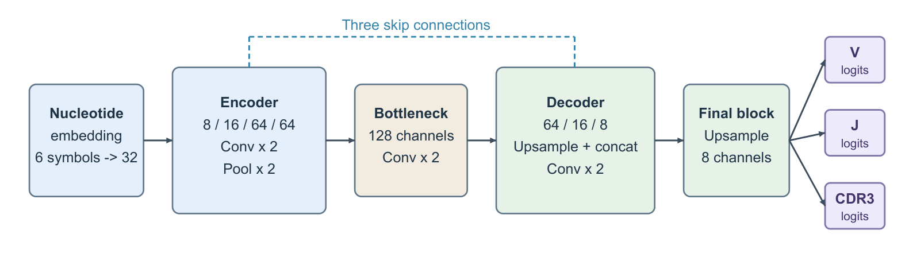
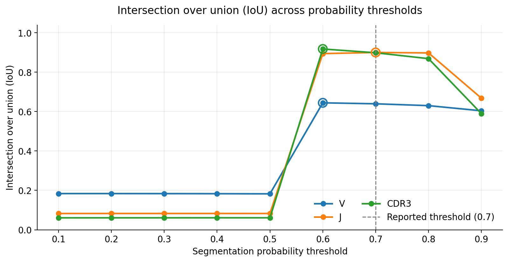
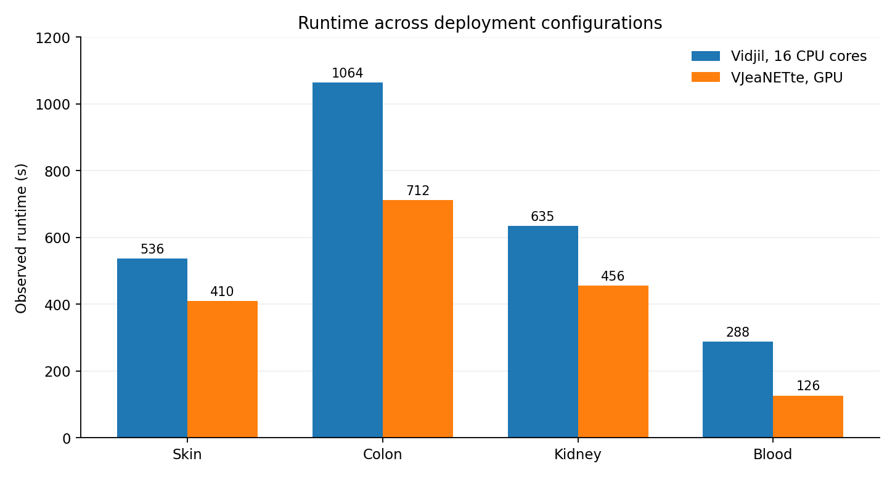

# VJeaNETte

**Neural pre-filtering and nucleotide-level localization of immune-receptor reads in FASTQ data.**

VJeaNETte uses a one-dimensional U-Net-like model with independent output heads for **V, J and CDR3**. It identifies candidate immune-receptor reads and retains them as FASTA records for subsequent repertoire analysis.

> **Scope:** VJeaNETte is a candidate-selection tool, not a replacement for germline gene assignment, clonotype reconstruction or downstream repertoire annotation.

## About

V(D)J recombination generates diverse B-cell and T-cell receptors. Receptor-derived reads can be present in conventional RNA-seq data, where detailed annotation of the entire input may be computationally costly. VJeaNETte predicts per-nucleotide evidence of receptor regions and aggregates these predictions into read-level retention decisions.

Key features:

- Three position-wise prediction heads: **V, J and CDR3**.
- Forward- and reverse-complement evaluation.
- GPU-accelerated inference with optional mixed precision.
- Batched FASTQ processing, configurable worker count and a command-line interface.
- IgBLAST-derived training targets and reproducible preprocessing/training notebooks.

## Model architecture



*Architecture from Fig. 1 of the accompanying paper.* Nucleotides (A, C, G, T, N and padding) are represented by learned 32-dimensional embeddings. A one-dimensional encoder–decoder with skip connections produces separate V, J and CDR3 probability tracks. The encoder has four stages (8, 16, 64 and 64 channels), followed by a 128-channel bottleneck.

At inference time, the position-wise probabilities are summarized by the maximum averaged probability in windows of **15 nt (V), 10 nt (J) and 6 nt (CDR3)**. Both strands are assessed and one is selected. A read is retained when **at least one** of the three heads detects a candidate region; both V and J are *not* required for retention.

## Results

The accompanying manuscript evaluates the model using **IgBLAST-derived reference annotations** on four datasets: Blood (TCR-seq), plus Skin, Kidney and Colon (RNA-seq). Reference labels represent computational annotations, not independently validated biological ground truth.

### Read-level detection versus Vidjil-algo 2026.06

| Dataset | Vidjil P | Vidjil R | Vidjil F1 | VJeaNETte P | VJeaNETte R | VJeaNETte F1 |
|:--|--:|--:|--:|--:|--:|--:|
| Blood | 0.999 | 1.000 | 0.999 | 1.000 | 0.990 | 0.995 |
| Skin | 0.706 | 0.956 | 0.812 | 0.805 | 0.964 | 0.877 |
| Kidney | 0.768 | 0.964 | 0.855 | 0.792 | 0.869 | 0.829 |
| Colon | 0.813 | 0.961 | 0.881 | 0.852 | 0.980 | 0.912 |

**P** = precision; **R** = recall. The performance difference depends on the dataset: VJeaNETte achieves higher F1 on Skin and Colon, but its recall on Kidney is lower than Vidjil's. The comparison is based on IgBLAST-derived read labels.

### Nucleotide-level localization

| Region | Precision | Recall | F1 | IoU | Median start error | Median end error |
|:--|--:|--:|--:|--:|--:|--:|
| V | 0.9814 | 0.6475 | 0.7802 | 0.6397 | 1 nt | 2 nt |
| J | 0.9269 | 0.9691 | 0.9475 | 0.9003 | 2 nt | 0 nt |
| CDR3 | 0.9366 | 0.9571 | 0.9467 | 0.8988 | 1 nt | 0 nt |

*Values reported in the manuscript for its validation partition at nucleotide-mask threshold 0.7.* The separate read-level detection threshold is 0.5. Boundary errors are calculated for matched regions and should be read alongside recall.



### Leave-one-dataset-out generalization

| Dataset held out | Precision | Recall | F1 |
|:--|--:|--:|--:|
| Blood | 0.998 | 0.953 | 0.975 |
| Skin | 0.732 | 0.964 | 0.832 |
| Kidney | 0.760 | 0.812 | 0.785 |
| Colon | 0.605 | 0.999 | 0.754 |

For each row, the evaluated dataset was excluded from VJeaNETte training. These results highlight **dataset-dependent generalization**; recall is particularly limited on held-out Kidney and precision on held-out Colon.

### Runtime benchmark



| Dataset | Vidjil 2026.06 (16 CPU cores) | VJeaNETte (GPU) | Ratio |
|:--|--:|--:|--:|
| Skin | 536.04 s | 409.58 s | 1.31× |
| Colon | 1064.13 s | 711.94 s | 1.49× |
| Kidney | 634.71 s | 455.83 s | 1.39× |
| Blood | 288.31 s | 126.33 s | 2.28× |

The recorded mean runtime was **630.80 s** for Vidjil and **425.92 s** for VJeaNETte (**32.5% lower**). These are observations from **different hardware configurations** (16-core CPU versus GPU), not a controlled hardware-normalized speed comparison or a full downstream annotation pipeline benchmark.

### Evaluation datasets

| Dataset | Assay | Run | Original layout |
|:--|:--|:--|:--|
| Blood | TCR-seq | `SRR33672930` | Single-end |
| Kidney | RNA-seq | `SRR5494024` | Paired-end |
| Colon | RNA-seq | `SRR18748718` | Paired-end |
| Skin | RNA-seq | `SRR10245671` | Paired-end |

The evaluation processes individual reads; **Kidney uses R1 only**, with the same R1 supplied to comparison methods. The model does not use paired-mate linkage.

## Installation

Clone the repository:

```bash
git clone https://github.com/BelyashMatvey/vjeanette.git
cd vjeanette
```

If the repository contains the supplied `Makefile`, install dependencies with:

```bash
make setup
```

For development, the original project also documents `make setup-dev`. CUDA-enabled PyTorch must be installed in a version compatible with your operating system, Python environment and CUDA driver; consult the [official PyTorch installation instructions](https://pytorch.org/get-started/locally/).

> **Requirements:** The inference code uses PyTorch, NumPy and a local model checkpoint. The complete dependency specification and Makefile were not provided for verification, so confirm your installed environment before running the CLI.

## Quick start: FASTQ to filtered FASTA

Run inference through the Python module:

```bash
python -m vjeanette.run \
  --in_file "path to file.fastq" \
  --out_file "path to file.fasta" \
  --model_path "path to file.pth" \
  --device cuda \
  --batch_size 32768 \
  --n_cores 1
```

Use `--device cpu` if CUDA is unavailable. A working model checkpoint must be supplied. The optional `--compile` flag enables `torch.compile` in the cleaned CLI version; it is not needed for basic inference.

The installed entry point may also be available as `vjea-infer`, depending on the package configuration. Run `python -m vjeanette.run --help` to inspect the Python-module CLI.

### Inference arguments

| Argument | Purpose | Default in Python CLI |
|:--|:--|:--|
| `--in_file` | Input FASTQ | From `pyproject.toml` |
| `--out_file` | Output **FASTA** | From `pyproject.toml` |
| `--model_path` | Model weights (`.pth`) | From `pyproject.toml` |
| `--device` | `cuda` or `cpu` | `cuda` |
| `--batch_size` | Reads per inference batch | `32768` |
| `--n_cores` | DataLoader workers | `1` |
| `--logs` | Log-file path | CLI default; override as needed |
| `--compile` | Enable `torch.compile` | Disabled |

### Output format

The current `core.py` writes **FASTA**, not CSV. Only retained reads are written. Headers contain the original read identifier plus a score and three binary detection flags:

```fasta
>example_read score=3.250000 has_v=1 has_j=0 has_cdr3=0
ACGTACGTACGT
```

This is an **illustrative format example**, not an actual inference result. The present CLI does **not** export nucleotide coordinates, strand labels or a per-read CSV table, despite the model internally producing position-wise predictions.

## Configuration (`pyproject.toml`)

The provided CLI uses the following configuration section when corresponding path flags are omitted:

```toml
[tool.vjeanette.test]
input = "path to file.fastq"
output = "path to file.fasta"
model_path = "path to file.pth"
```

Replace the placeholders with real paths. The original README also documents a preprocessing configuration and training parameters, including `epochs = 130`, `batch_size = 256`, `lr = 0.0003` and `embed_dim = 32`; check the actual `pyproject.toml` before relying on additional keys, as that file was not included in the code audit.

## Training and notebooks

The repository contains Python preprocessing and training modules and notebooks demonstrating individual stages of the workflow:

| Notebook | Purpose |
|:--|:--|
| `preprocessing.ipynb` | Combine Ig/TCR annotations, apply V/J quality criteria, generate nucleotide masks and serialize tensors |
| `train.ipynb` | Dataset splitting, optimization, validation and checkpointing |
| `inference.ipynb` | Demonstrate prediction and strand handling |
| `seg_metrics.ipynb` | Evaluate nucleotide segmentation and threshold sensitivity |

The cleaned notebooks may have different filenames from an older README (`01_preprocessing.ipynb`, `02_train.ipynb`, etc.); update links to match files committed to the repository.

Training targets use independent V and J criteria (**V identity > 80%, score > 50; J identity > 90%, score > 40**). CDR3-positive labels require both criteria and an annotated CDR3 interval. Target tensors are ordered `[CDR3, V, J]`, with reads padded to 512 nucleotides.

The corrected training workflow uses a fixed seed of 42, a **63% / 7% / 30% train/validation/test split**, Adam with an initial learning rate of `3e-4`, batch size 256, and early stopping. See the notebooks and CLI help for full options.

> **Reproducibility note:** The segmentation evaluation notebook and production inference use different strand-selection rules, and the segmentation notebook's masking behavior was updated during code review. Re-run the evaluation before treating the cleaned notebook as a byte-for-byte reproduction of the manuscript's segmentation numbers.

## Project layout

```text
vjeanette/
├── pyproject.toml
├── Makefile
├── README.md
├── vjeanette/
│   ├── config.py
│   ├── core.py
│   ├── parser.py
│   ├── preprocessing.py
│   ├── run.py
│   ├── train.py
│   ├── utils.py
│   └── model/
│       └── model.py
├── notebooks/
│   ├── preprocessing.ipynb
│   ├── train.ipynb
│   ├── inference.ipynb
│   └── seg_metrics.ipynb
├── pics/
├── weights/
└── out/
```

This layout reflects the supplied modules and the documented repository structure; `model/model.py`, `pyproject.toml`, and the `Makefile` were not part of the files provided for the code review.

## Paper and limitations

**VJeaNETte: Fast Neural Pre-filtering of Immune-Receptor Reads in RNA-seq Data** — Matvei Beliakov, Elizaveta Vlasova, Mikhail Shugay.

The manuscript reports read-level agreement with IgBLAST-derived labels, segmentation of V/J/CDR3-associated intervals, leave-one-dataset-out testing and deployment-specific runtime measurements. The tool is not yet validated as an end-to-end replacement for repertoire reconstruction, and sensitivity can change substantially across data sources.

## Authors

- Matvei Beliakov — Saint Petersburg State University
- Elizaveta Vlasova — ITMO University
- Mikhail Shugay — Pirogov Russian National Research Medical University

## Contact

neonlight20006@gmail.com

## Status

Active development.
